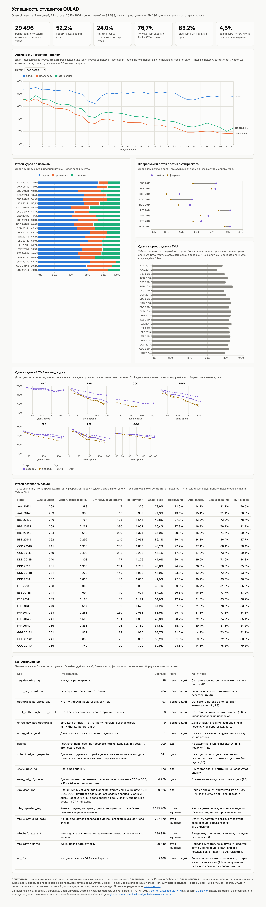

# Успешность студентов Open University · Student success on Open University data

[](https://github.com/mrovchinnikov95/oulad-learning-analytics/actions/workflows/build.yml) · [dashboard](https://mrovchinnikov95.github.io/oulad-learning-analytics/dashboard/)

## In English

<!-- checked-en:start -->
**Summary.** This project builds data marts on the Open University Learning Analytics Dataset (OULAD, open data under CC BY 4.0): assessment submission, on-time submission, pass rates by module and presentation, and weekly cohort activity. It has PostgreSQL layers `raw → clean → mart`, SQL checks that stop the build, a second independent calculation in pandas that reads the CSV files directly, CI on GitHub Actions, and a static Vega-Lite dashboard ([live](https://mrovchinnikov95.github.io/oulad-learning-analytics/dashboard/)). A "presentation" is one run of a module (2013J started in October 2013, 2014B in February 2014); a "student" is one registration on one presentation. Of 29,496 students who started one of 22 presentations, 52.2% passed the module.

**Findings.**

1. *The first assessment is an early warning one week after its deadline.* On the deadline day 33.0% of students had not submitted it, but many submit late, and 33.4% of them still passed the module. A week after the deadline 3,490 students (12.7%) still had not submitted it; only 10.0% of them passed, compared with 62.2% of the others. This is an association, not a proven cause, and it catches about one in four of the students who later do not pass.
2. *Failure does not show up as unregistration.* In week 12, 7,042 of the 7,044 students who later failed were still registered, but only 39.1% of them used the course website that week, compared with 76.9% of those who passed.
3. *February presentations pass fewer students than October ones* in all 9 pairs of the same module and year, by 1.2 to 7.5 pp. The direction is the same everywhere, but in more than half of the pairs the gap alone is within random variation, and February presentations are shorter.
<!-- checked-en:end -->

**How to run.** You need `make`, `curl`, `unzip`, PostgreSQL 16 or newer and Python 3 with pandas. `make data db build test check` downloads the data from UCI (about 45 MB), starts a local cluster, builds the marts, runs the SQL checks and the corruption tests, then the independent recompute and the README number check. The same steps run in GitHub Actions on every push. Details are in «Как запустить»; the full definitions are in [docs/spec.md](docs/spec.md) (in Russian). Built with Claude Code: the task, the verification requirements and the acceptance are mine; the AI's mistakes and how they were caught are in [docs/ai-notes.md](docs/ai-notes.md).

## По-русски

Учебный проект на открытых данных: витрины в PostgreSQL, проверки, которые останавливают сборку, независимый пересчёт на Python и статический дашборд. Данные — анонимизированные записи Open University (Великобритания) за 2013–2014 годы. VLE — сайт курса, TMA — задания с проверкой тьютором, CMA — тесты с автоматической проверкой. «Студент» в тексте — регистрация на поток: человек, который учился в двух потоках, посчитан дважды. Сделано с Claude Code: постановка, требования к проверкам и приёмка — мои, код писали агенты. Правила работы — в [CLAUDE.md](CLAUDE.md), ошибки ИИ и как их поймали — в [docs/ai-notes.md](docs/ai-notes.md).

<!-- checked:start -->
**Коротко.** Из 29 496 студентов, которые приступили к 22 потокам 7 модулей, курс сдали 52,2%: от 40,2% в CCC 2014B до 73,9% в AAA 2013J. Ранний сигнал риска — первое задание: через неделю после срока его не сдали 3490 студентов, и из них курс сдали 10,0%, а из остальных — 62,2%. Провал по отпискам не виден: на неделе 12 на курсе числятся 7042 из 7044 студентов, которые потом провалят курс, но в VLE за неделю заходят только 39,1% из них, а среди тех, кто курс сдаст, — 76,9%. В февральских потоках курс сдают хуже, чем в октябрьских того же модуля и года: так во всех 9 таких парах.
<!-- checked:end -->

Все числа в выводах пересчитаны вторым, независимым кодом прямо из CSV; как это проверено — [ниже](#как-проверено-что-цифры-верны).

| | |
|---|---|
| Дашборд | [mrovchinnikov95.github.io/oulad-learning-analytics/dashboard](https://mrovchinnikov95.github.io/oulad-learning-analytics/dashboard/) |
| Определения метрик | [docs/spec.md](docs/spec.md) — полные определения; в README и на дашборде — короткие пояснения |
| Данные | OULAD, Kuzilek, Hlosta, Zdrahal, *Scientific Data* 4, 170171 (2017), лицензия CC BY 4.0 |
| Автор | Александр Овчинников, аналитик данных |
| Сверено с данными | 28.10.2026 |

## Содержание

- [In English](#in-english)
- [Итоги по модулям](#итоги-по-модулям)
- [Три вывода](#три-вывода)
- [Дашборд](#дашборд)
- [Как проверено, что цифры верны](#как-проверено-что-цифры-верны)
- [Как запустить](#как-запустить)
- [Решения по определениям](#решения-по-определениям)
- [Качество данных](#качество-данных)
- [Что где лежит](#что-где-лежит)
- [Источник и лицензия](#источник-и-лицензия)

## Итоги по модулям

Приступили — зарегистрированные на поток без тех, кто отписался в день старта или раньше. Сдали курс — итог Pass или Distinction среди приступивших, отписались — итог Withdrawn среди приступивших. Сдача заданий — доля сданных заданий TMA и CMA среди положенных: задание положено, если студент числился на курсе в день срока. TMA в срок — доля сданных в день срока или раньше среди сданных. Таблица собирается из `dashboard/data/presentation_outcome.json` командой `python3 -I checks/check_readme_numbers.py --write`, руками не правится.

<!-- modules-table:start -->
| Модуль | Потоков | Приступили | Сдали курс | Отписались | Сдача заданий | TMA в срок |
|---|---:|---:|---:|---:|---:|---:|
| AAA | 2 | 728 | 72,9% | 14,6% | 92,0% | 73,8% |
| BBB | 4 | 6921 | 54,2% | 20,3% | 76,4% | 82,4% |
| CCC | 2 | 3935 | 42,6% | 37,5% | 70,5% | 79,4% |
| DDD | 4 | 5676 | 46,0% | 29,2% | 76,9% | 85,2% |
| EEE | 3 | 2701 | 61,1% | 18,1% | 81,5% | 85,3% |
| FFF | 4 | 7069 | 51,6% | 24,2% | 78,4% | 84,2% |
| GGG | 3 | 2466 | 61,4% | 9,1% | 73,7% | 82,1% |
| Все модули | 22 | 29 496 | 52,2% | 24,0% | 76,7% | 83,2% |
<!-- modules-table:end -->

## Три вывода

<!-- checked:start -->
**1. Ранний сигнал риска — первое задание через неделю после срока.** Первое задание своего потока должны были сдать 27 394 студента. В сам день срока его не сдали 33,0%, но это ещё не сигнал: многие сдают с опозданием, и из не сдавших к сроку курс сдали 33,4% (из 6193 опоздавших — 46,6%). Через неделю после срока задание всё ещё не сдали 3490 студентов (12,7%): из них курс сдали 10,0%, а из остальных — 62,2%. Дальше картина почти не меняется: из тех, кто так и не сдал первое задание, курс сдали 4,5%, но это известно только задним числом. Это связь, а не доказанная причина: несдача может быть следствием того же, что потом приводит к провалу. Вес задания в оценке разрыв не объясняет: в четырёх потоках первое задание в оценку не входит, а разрыв там такой же большой. В трёх потоках, где первое задание — CMA, к записанному сроку не сдал никто (срок CMA записан не как крайний, см. ниже), а через неделю доля не сдавших там такая же, как в остальных потоках. Неделя ожидания почти ничего не стоит: большинство тех, кто потом отписывается, делают это позже. Но охват у сигнала небольшой: из тех, кто потом курс не сдал, за неделю первое задание не сдал примерно каждый четвёртый.

*Что сделать:* через неделю после срока первого задания связываться с каждым, кто его так и не сдал, — это 12,7% тех, кто должен был сдать. Меняет ли звонок итог, по этим данным не измерить: это стоит проверить на части потоков.

**2. Провал по отпискам не виден.** Отписавшимся в наборе ставится итог Withdrawn, поэтому у провалившихся отписки почти нет: среди приступивших с итогом Fail дата отписки есть только у одного. Из 7044 приступивших, которые потом провалили курс, на неделе 12 на курсе числились 7042. Но заходили в VLE за эту неделю только 39,1% из них, а среди тех, кто курс сдал, — 76,9%, почти вдвое больше. Сдавшие активнее провалившихся на каждой неделе курса: разрыв есть уже на неделе 0 и к неделе 12 растёт (график «Активность когорт» на дашборде). Неделя 12 — примерно треть курса; на ней сдавшие активнее во всех 22 потоках.

*Что сделать:* следить не только за отписками, но и за долей активных среди тех, кто числится на курсе. Одна неделя без входа сама по себе мало что значит: за недели 0–12 такая неделя бывает у двух третей тех, кто курс сдаёт. Три недели подряд без входа отличают лучше: за те же недели они бывают у большинства провалившихся и меньше чем у каждого пятого сдавшего.

**3. Февральские потоки сдают хуже октябрьских.** В каждой из 9 пар «один модуль, один год» февральский поток ниже на 1,2–7,5 п.п. Больше чем в половине пар разница по отдельности укладывается в случайный разброс: вывод держится на том, что знак везде один. Если считать от всех регистраций, а не от приступивших, в одной паре (FFF 2013) февраль чуть выше. Почему так, по этим данным не понять: февральские потоки короче (234–241 день против 261–269), состав студентов может отличаться, а авторы набора советуют анализировать потоки B и J отдельно.

*Что сделать:* сравнивать поток с прошлыми потоками того же месяца старта, а не с общим средним, иначе разницу между февралём и октябрём примут за изменение качества курса.

**Про сроки CMA.** Долю «в срок» здесь можно считать только по заданиям TMA: в срок пришли 83,2% сдач. У CMA поле срока не ведёт себя как срок отдельного задания. В 3 модулях (BBB, CCC, DDD) в срок пришли 2 сдачи из 30 526: почти все сдачи одного задания записаны одним и тем же днём, на несколько дней позже срока. В FFF и GGG у всех CMA потока один общий срок в конце курса, и до него приходят 94,1% сдач; в AAA и EEE заданий CMA нет. Что именно записано в поле, по данным не установить, поэтому CMA в долю «в срок» не входят.
<!-- checked:end -->

Каждое число в выводах, записанное цифрами, должно совпадать с подписью одного из фактов `mart.readme_facts` (колонка `display`) или со счётчиком `qa.data_quality`; исключения — номера недель 0 и 12, годы 2013–2014 и число из `OULAD.names`. `checks/check_readme_numbers.py` проверяет только это совпадение: стоит ли число на своём месте (7042, а не 7044), он не видит: это сверено вычиткой рецензентов и отдельными запросами. `checks/verify_independent.py` пересчитывает сами факты заново из CSV. Утверждения словами («во всех 9», «на каждой неделе», «почти вдвое», «две трети», «большинство», «каждый четвёртый», «каждый пятый», «такой же большой», «больше чем в половине пар», «только у одного», «одним и тем же днём») сверены отдельными запросами и пересчётом рецензента, автоматическая проверка их не видит; числа, которые совпадают с фактами случайно (например, 2 и 3), она тоже не отличит.

## Дашборд

[Открыть дашборд](https://mrovchinnikov95.github.io/oulad-learning-analytics/dashboard/). Плитки ключевых метрик, активность когорт по неделям с выбором потока, итоги курса по потокам, сравнение февральских и октябрьских потоков, сдача TMA в срок, сдача заданий TMA по дню срока, таблица итогов и таблица качества данных. Страница статическая: читает `dashboard/data/*.json`, графики — спеки Vega-Lite в `dashboard/specs/`. Есть тёмная тема, на телефоне графики перестраиваются под ширину.



## Как проверено, что цифры верны

<!-- checked-tooling:start -->
Коротко: сборка останавливается на любой из 105 SQL-проверок; все выгрузки построчно пересчитаны вторым кодом на pandas прямо из CSV, 607 289 значения без расхождений; каждую из 29 порч данных, правил и витрин ловит свой контроль.

1. **Проверки сырья** (`sql/25_raw_checks.sql`, 62 проверки, до построения витрин): число строк в каждом файле как в статье об OULAD, обязательные поля, форматы чисел, допустимые значения, уникальность ключей, связи между таблицами, порядок дат. Проверки читают сырые строки напрямую, а не типизированные таблицы, иначе битое значение уронило бы приведение типа раньше, чем проверка скажет, в чём дело. Перед загрузкой CSV сверяются с `data/SHA256SUMS`.
2. **Проверки витрин** (`sql/90_checks.sql`, 43 проверки, до выгрузки): граничные случаи правил на синтетических значениях (день старта, день срока, первый и последний день недели), граничные строки в самих данных (сдача ровно в день срока, отписка в день срока и за день до него), сверки витрин с сырьём и между собой, мост кликов (все клики журнала раскладываются на клики когорт и три остатка), инварианты. Любая непрошедшая проверка останавливает сборку, и выгрузка для дашборда не перезаписывается.
3. **Независимый пересчёт** (`checks/verify_independent.py`): второй расчёт на pandas прямо из CSV, без базы. По журналу работы (в репозиторий он не входит) его писал отдельный агент, которому дали только [docs/spec.md](docs/spec.md) и CSV, без доступа к SQL (девять фактов о первом задании позже дописал так же другой агент); ещё один агент проверял пересчёт на соответствие спецификации и пытался заставить его пройти впустую. Поэтому ошибку в коде он ловит, а ошибку в самой спецификации — нет: её искали рецензенты (последний пункт списка). Сверяет все выгрузки построчно, включая витрину студентов: 607 289 значения, расхождений 0. Не сверяются только текстовые колонки `unit`, `description` и `handling` в `data_quality`: их спецификация не определяет. Целые сравниваются точно, доли — с допуском `1e-12`. Самопроверка (`--self-test`) портит выгрузки 31 способом и требует, чтобы каждая порча была поймана.
4. **Числа README** (`checks/check_readme_numbers.py`): в проверяемых блоках нет чисел, которых нет среди подписей фактов и счётчиков качества данных; таблица по модулям совпадает с выгрузкой; числа этого раздела совпадают с логами последних `make build`, `make test` и `make check`.
5. **Проверка проверок** (`scripts/test_controls.sh`): 29 видов порчи — битые значения, дубли, потерянные строки, сдвинутые границы в правилах, лишняя сдача в витрине, переставленные колонки в CSV, изменённый файл. Каждую ловит свой контроль, а выгрузка при упавшей сборке не перезаписывается.
6. **Идемпотентность и версии**: повторная сборка даёт побайтно те же выгрузки (`scripts/test_idempotency.sh`); сборка прогнана на PostgreSQL `16.15` и `17.11`, выгрузки совпали побайтно.
<!-- checked-tooling:end -->
7. **Дашборд** проверяется по скриншоту в светлой и тёмной теме, на ширине планшета и телефона: `scripts/screenshot.mjs` падает на любой ошибке или предупреждении в консоли, на горизонтальной прокрутке страницы и на графике шире своей карточки.
8. **Рецензия**: до публикации четыре независимых агента пытались сломать выводы, воспроизводимость с чистого клона, тексты и дашборд, у каждого был свой контекст. Что они нашли — в [docs/ai-notes.md](docs/ai-notes.md).

## Как запустить

Нужны `make`, `curl`, `unzip`, PostgreSQL 16 или новее (`initdb`, `pg_ctl`, `psql` и `createdb` в `PATH` или каталог с ними в `PG_BIN`: для Homebrew — `/opt/homebrew/opt/postgresql@16/bin`, для Debian и Ubuntu — `/usr/lib/postgresql/16/bin`) и Python 3 с pandas, который виден при `python3 -I` (venv или системный пакет; `pip install --user` не подойдёт). Node и Playwright нужны только для скриншота.

```bash
make data db build test check
```

- `make data` скачивает архив с UCI Machine Learning Repository (около 45 МБ) и сверяет архив и CSV с `data/SHA256SUMS`;
- `make db` поднимает одноразовый кластер в `./.pgdata` на `localhost:54331`;
- `make build` загружает CSV, строит витрины, гоняет проверки и выгружает JSON для дашборда (около полутора минут);
- `make test` — идемпотентность и проверка проверок (около 15 минут); его лог `.tmp/test_controls.out` нужен `make check`, поэтому `test` идёт раньше `check`;
- `make check` — независимый пересчёт и числа README;
- `make screenshot` — снимок дашборда в `docs/dashboard.png` (тёмный, планшетный и телефонный — в `.tmp/`); перед первым запуском `npm install && npx playwright install chromium`, нужны Node 18+ и интернет: Vega грузится с cdn.jsdelivr.net;
- `make stop` останавливает кластер, `make reset` удаляет `./.pgdata` и поднимает его заново.

Свой сервер — через переменные `PGHOST`, `PGPORT`, `PGUSER`, `PGPASSWORD`, `PGDATABASE` (см. `scripts/env.sh`). Базу `$PGDATABASE` создайте заранее; для `make test` нужна роль с правом `CREATEDB`: тест создаёт и удаляет базу `${PGDATABASE}_test`. Дашборд локально: `python3 -m http.server -d dashboard` и открыть `http://localhost:8000`.

## Решения по определениям

Полные определения — в [docs/spec.md](docs/spec.md), при расхождении права она. Здесь только решения, где набор допускает разные прочтения.

- **Студент** — регистрация студента на поток. Один человек мог учиться в нескольких потоках, и тогда он посчитан в каждом; так же считают авторы набора.
- **Кто в потоке.** Студент, который отписался в день старта или раньше, к потоку не приступал и в знаменатели не входит. Иначе доля сдавших занижается теми, кто курс даже не начинал.
- **Кто должен был сдать задание.** Тот, кто числился на курсе в день срока: зарегистрировался не позже и отписался не раньше. Сдачи от остальных в долю не входят и считаются отдельно, в таблице качества данных (`submitted_not_expected`). Результаты, перенесённые из прошлого потока (`is_banked`), не входят ни в знаменатель, ни в численник: у них день сдачи −1, это не дата сдачи.
- **Экзамены не входят.** Результаты экзаменов в наборе есть только в модулях CCC и DDD, у части экзаменов нет даты.
- **В срок** — в день срока или раньше, и только TMA (см. «Про сроки CMA» выше).
- **Активность недели** — хотя бы один клик в VLE за неделю курса. Это решение устойчиво к повторам в журнале: строки с одинаковым «студент, материал, день» встречаются больше двух миллионов раз, и на число кликов они влияют, а на факт активности — нет.
- **Неделя курса** считается от старта потока: дни 0–6 — неделя 0, дни 7–13 — неделя 1. Студент входит в когорту недели, если числился на курсе хотя бы один её день. Последняя неделя потока неполная, на дашборде её нет.

## Качество данных

<!-- checked:start -->
Что нашлось и как учтено (полная таблица — на дашборде и в `qa.data_quality`):

- 2 195 960 строк журнала VLE повторяют ключ «студент, материал, день», из них 787 170 совпадают с другой строкой полностью. Клики суммируются; отличить повторную выгрузку от второй сессии за день нельзя, поэтому активность считается по факту клика.
- 1909 результатов перенесены из прошлого потока и не входят в доли сдачи.
- 1541 сдача пришла от студентов, которые в день срока не числились на курсе; в доли не входит.
- 93 регистрации с итогом Withdrawn без даты отписки остаются в потоке; 8 регистраций с итогом Fail отписались в день старта или раньше и в поток не входят.
- 45 регистраций без даты регистрации считаются зарегистрированными с начала потока.
- 3365 регистраций без единого клика в VLE: большинство из них отписались до старта и в поток не входят, остальные остаются в знаменателях.
- В разделе «Number of Instances» описания набора `OULAD.names` число студентов и регистраций записано как 32953; в файлах, в статье и в таблице итогов того же описания — 32 593.
<!-- checked:end -->

## Что где лежит

| Путь | Что там |
|---|---|
| `Makefile` | короткие команды |
| `data/SHA256SUMS` | контрольные суммы архива и CSV |
| `sql/00_schemas.sql` | схемы `raw`, `rules`, `clean`, `mart`, `qa` |
| `sql/05_rules.sql` | все правила в функциях: неделя, «приступил», «числится на курсе», «в срок», порог для сроков CMA, группа итога |
| `sql/10_raw_tables.sql`, `sql/20_raw_load.sql` | слой `raw`: CSV как есть, всё текстом, с номером строки файла |
| `sql/25_raw_checks.sql` | проверки сырья |
| `sql/30_clean.sql` | слой `clean`: типы, пропуски, ключи |
| `sql/40_marts.sql` | витрины: `expected_submission`, `assessment_submission`, `student_presentation`, `presentation_outcome`, `cohort_week_activity` |
| `sql/50_quality.sql`, `sql/60_facts.sql` | качество данных и факты для README |
| `sql/90_checks.sql` | проверки витрин |
| `checks/` | независимый пересчёт и проверка чисел README |
| `scripts/` | кластер, загрузка данных, сборка, выгрузка, тесты, скриншот |
| `dashboard/` | страница, спеки Vega-Lite, выгруженные JSON |
| `docs/spec.md` | определения метрик и формат выгрузок |
| `docs/ai-notes.md` | где ИИ ошибся и что исправлено |
| `index.html` | переход на дашборд для GitHub Pages |
| `.github/workflows/build.yml` | сборка с нуля и все проверки в GitHub Actions |
| `package.json` | Playwright для скриншота |

## Источник и лицензия

Данные: Kuzilek J., Hlosta M., Zdrahal Z. Open University Learning Analytics dataset. *Scientific Data* 4, 170171 (2017), [doi:10.1038/sdata.2017.171](https://doi.org/10.1038/sdata.2017.171). Набор распространяется по лицензии [CC BY 4.0](https://creativecommons.org/licenses/by/4.0/); копия — в [UCI Machine Learning Repository](https://archive.ics.uci.edu/dataset/349/open+university+learning+analytics+dataset) ([doi:10.24432/C5KK69](https://doi.org/10.24432/C5KK69)). Старая страница набора на сайте Open University (`analyse.kmi.open.ac.uk/open_dataset`) на 27.10.2026 перенаправляет на страницу проекта OU Analyse без ссылки на данные, поэтому `scripts/get_data.sh` качает копию UCI и сверяет её контрольными суммами. Исходные CSV в репозиторий не копируются. Агрегаты в `dashboard/data/` и скриншот `docs/dashboard.png` — изменённая производная набора: данные сведены по потокам, заданиям и неделям; они распространяются по той же лицензии CC BY 4.0.

Код — лицензия MIT, см. [LICENSE](LICENSE).
